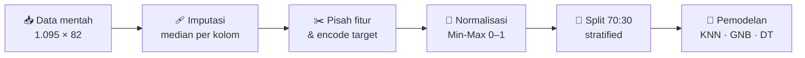
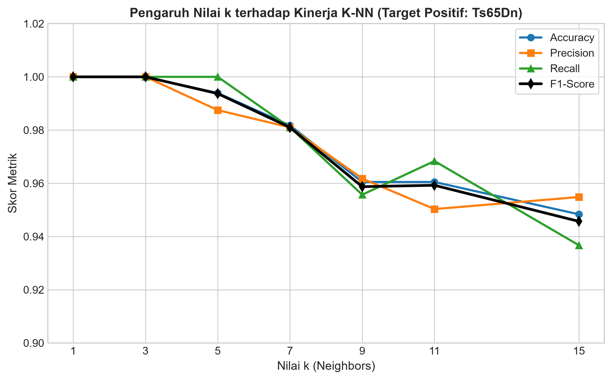
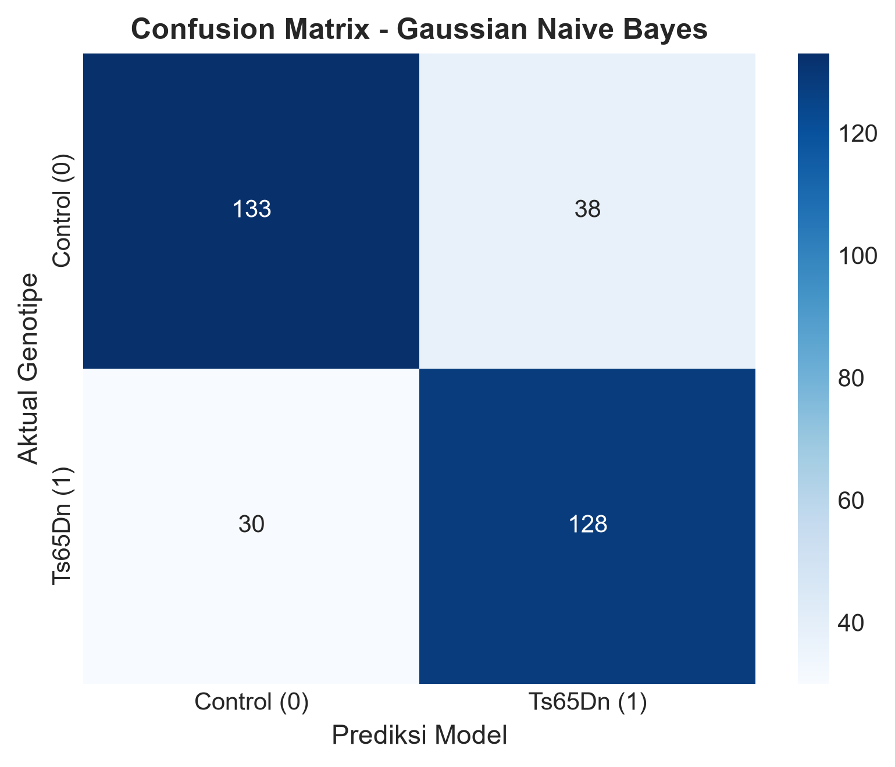
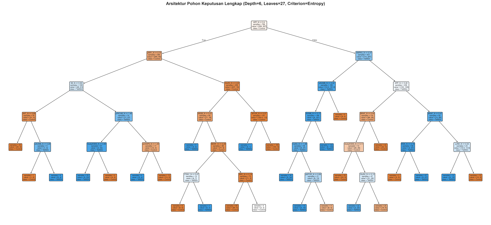
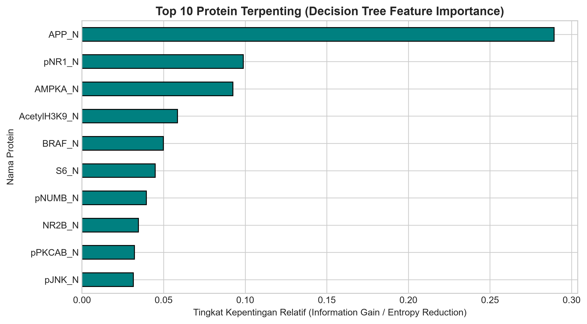
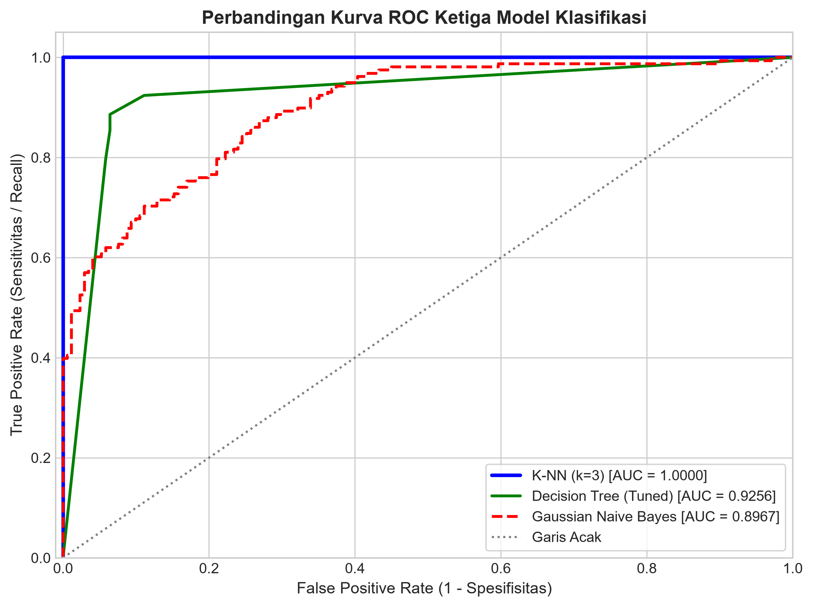

<div align="center">

# 🧬 Klasifikasi Genotipe Tikus dari Profil Ekspresi Protein

### K-Nearest Neighbor · Gaussian Naive Bayes · Decision Tree

*Membedakan tikus **Control** dan **Ts65Dn** (model Down Syndrome) dari ekspresi 77 protein korteks serebral*


</div>

---

## 📋 Informasi Proyek

| | |
|---|---|
| **Mata Kuliah** | SINF-3035 Data Mining (UTS / Project Individu) |
| **Penulis** | Muhammad Aqil Mubarak (`250810701100003`) |
| **Institusi** | Departemen Informatika, FMIPA, Universitas Syiah Kuala |
| **Tahun** | 2026 |

---

## 🏆 Hasil Sekilas

| Model | Akurasi | Precision | Recall | F1-Score | AUC-ROC |
| :--- | :---: | :---: | :---: | :---: | :---: |
| 🥇 **K-NN** (k=3) | **1,0000** | **1,0000** | **1,0000** | **1,0000** | **1,0000** |
| 🥈 **Decision Tree** (Tuned) | 0,8967 | 0,9247 | 0,8544 | 0,8882 | 0,9256 |
| 🥉 **Gaussian Naive Bayes** | 0,7933 | 0,7711 | 0,8101 | 0,7901 | 0,8967 |

> 💡 **Insight utama:** K-NN unggul secara metrik, tetapi bersifat *black-box*. **Decision Tree** menjadi kompromi terbaik untuk riset biomedis: akurasi tinggi (89,67%) plus aturan eksplisit dan peringkat biomarker, dengan `APP_N` sebagai akar pohon.

---

## 📑 Daftar Isi

1. [Penjelasan Masalah](#1--penjelasan-masalah)
2. [Ringkasan Dataset](#2--ringkasan-dataset-dan-statistik-deskriptif)
3. [Tahap Praproses](#3--tahap-praproses)
4. [Metode dan Hasil Eksperimen](#4--metode-dan-hasil-eksperimen)
5. [Perbandingan Model dan Kesimpulan](#5--perbandingan-model-dan-kesimpulan)
6. [Struktur Folder dan Cara Menjalankan](#6--struktur-folder-dan-cara-menjalankan)
7. [Referensi](#7--referensi)

---

## 1. 🔬 Penjelasan Masalah

**Down Syndrome (DS)** adalah kelainan genetik bawaan akibat trisomi kromosom 21 manusia (*trisomy 21*). Kelebihan salinan kromosom ini memicu ketidakseimbangan dosis ekspresi gen (*gene dosage effect*) yang mengganggu jalur pensinyalan sinaptik di otak, sehingga menyebabkan defisit pembelajaran dan memori.

Dalam riset neurobiologi, tikus galur **Ts65Dn** digunakan sebagai model standar DS karena membawa salinan ekstra gen ortolog kromosom 21 manusia dan menunjukkan gangguan belajar kontekstual yang serupa. Higuera, Gardiner, dan Cios (2015) mengukur ekspresi **77 protein** di korteks serebral tikus dengan teknik *Reverse Phase Protein Array* (RPPA).

### ❓ Pertanyaan Penelitian

1. Bagaimana praproses yang tepat untuk data proteomik 77 fitur yang mengandung *missing values*, pencilan (*outliers*), dan perbedaan skala konsentrasi?
2. Bagaimana membangun model *supervised learning* yang mampu membedakan genotipe **Control (Normal)** dan **Ts65Dn (Trisomi)** secara akurat?
3. Dari **K-NN**, **Gaussian Naive Bayes (GNB)**, dan **Decision Tree (DT)**, metode mana yang paling sesuai ditinjau dari performa prediktif, ketahanan terhadap multikolinearitas protein, dan interpretabilitas biologis?

---

## 2. 📊 Ringkasan Dataset dan Statistik Deskriptif

**Mice Protein Expression** (`Data_Cortex_Nuclear.xlsx`), Higuera et al. (2015), *PLoS ONE*. DOI: [`10.1371/journal.pone.0129126`](https://doi.org/10.1371/journal.pone.0129126)

### 2.1 Dimensi dan Distribusi Kelas

| Aspek | Keterangan |
| :--- | :--- |
| **Jumlah sampel** | 1.095 pengukuran (73 tikus × 15 replikasi teknis) |
| **Jumlah kolom** | 82 (77 fitur protein numerik + 5 atribut metadata) |

| Atribut | Kategori | Jumlah | Persentase |
| :--- | :--- | :---: | :---: |
| **`Genotype`** (target) | `Control` (Normal, kelas 0) | 570 | 52,05% |
| | `Ts65Dn` (Trisomi, kelas positif 1) | 525 | 47,95% |
| **`Treatment`** | `Memantine` (penghambat reseptor NMDA) | 585 | 53,42% |
| | `Saline` (kontrol cairan) | 510 | 46,58% |
| **`Behavior`** | `S/C` (*Shock-Context*) | 555 | 50,68% |
| | `C/S` (*Context-Shock*) | 540 | 49,32% |

Distribusi kelas target **seimbang (*balanced*)**, sehingga akurasi tetap menjadi metrik yang bermakna.

### 2.2 Profil Nilai Hilang (*Missing Values*)

Seluruh 77 atribut protein memiliki nilai hilang dengan proporsi bervariasi:

| Nama Protein | Jumlah Missing | Persentase |
| :--- | :---: | :---: |
| `BCL2_N` | 300 | 27,40% |
| `H3MeK4_N` | 285 | 26,03% |
| `BAD_N` | 228 | 20,82% |
| `EGR1_N` | 225 | 20,55% |
| `H3AcK18_N` | 195 | 17,81% |
| `pCFOS_N` | 90 | 8,22% |
| `ELK_N`, `Bcatenin_N` | 18 | 1,64% |
| 28 protein lainnya | 15 | 1,37% |
| 41 protein lainnya | 3 – 7 | 0,27% – 0,64% |

### 2.3 Statistik Deskriptif 10 Protein Utama

Statistik 10 protein paling berpengaruh **sebelum praproses**:

| Protein | Count | Mean | Median | Min | Max | Std |
| :--- | :---: | :---: | :---: | :---: | :---: | :---: |
| `APP_N` | 1.092 | 0,4055 | 0,4029 | 0,2356 | 0,6327 | 0,0611 |
| `pNR1_N` | 1.092 | 0,8188 | 0,8194 | 0,2905 | 1,4082 | 0,1314 |
| `AMPKA_N` | 1.092 | 0,3676 | 0,3577 | 0,2264 | 0,7008 | 0,0626 |
| `AcetylH3K9_N` | 1.080 | 0,2165 | 0,1504 | 0,0525 | 1,4594 | 0,1853 |
| `BRAF_N` | 1.092 | 0,3819 | 0,3275 | 0,1439 | 2,1334 | 0,2168 |
| `S6_N` | 1.080 | 0,4292 | 0,4010 | 0,1302 | 0,8226 | 0,1374 |
| `pNUMB_N` | 1.092 | 0,3557 | 0,3467 | 0,1856 | 0,6311 | 0,0637 |
| `NR2B_N` | 1.092 | 0,5630 | 0,5622 | 0,1848 | 0,9720 | 0,0898 |
| `pPKCAB_N` | 1.092 | 1,5260 | 1,3767 | 0,5678 | 3,0614 | 0,4787 |
| `pJNK_N` | 1.092 | 0,3132 | 0,3209 | 0,0521 | 0,4934 | 0,0517 |

> ⚠️ **Pola & outlier:** Skala antarprotein sangat timpang (mis. `pPKCAB_N` mencapai 3,0614 sedangkan `pJNK_N` hanya 0,0521–0,4934). Distribusi juga miring (*skewed*) akibat pencilan pada `AcetylH3K9_N` dan `BRAF_N`, di mana *mean* jauh lebih tinggi daripada *median*.

---

## 3. ⚙️ Tahap Praproses



| # | Tahap | Penjelasan |
| :-: | :--- | :--- |
| 1 | **Imputasi median** | Nilai hilang diisi **median** tiap protein. Median dipilih dibanding *mean* karena data RPPA mengandung pencilan dan distribusi miring, sehingga median lebih *robust* terhadap nilai ekstrem. |
| 2 | **Pemisahan fitur & encoding target** | Metadata (`MouseID`, `Genotype`, `Treatment`, `Behavior`, `class`) dibuang dari matriks fitur **X**, menyisakan 77 atribut protein. Target `Genotype` di-encode biner: `Control = 0`, `Ts65Dn = 1` (kelas positif). |
| 3 | **Normalisasi Min-Max** | Seluruh fitur diubah ke rentang [0, 1] dengan `MinMaxScaler`. Krusial untuk K-NN karena jarak Euclidean akan didominasi protein berskala besar (mis. `NR2A_N`, `pPKCAB_N`) dan menenggelamkan protein berskala kecil. |
| 4 | **Stratified split 70:30** | **766 data latih** dan **329 data uji** via `train_test_split(..., test_size=0.30, random_state=42, stratify=y)` agar proporsi kelas tetap seimbang. |

---

## 4. 🧪 Metode dan Hasil Eksperimen

### 4.1 K-Nearest Neighbor (K-NN)

**Cara kerja:** algoritma *instance-based learning* non-parametrik yang menentukan kelas sampel uji lewat *majority voting* dari **k** tetangga terdekat pada data latih ternormalisasi, memakai jarak Euclidean di ruang 77 dimensi.

**Variasi nilai k:**

| k | Accuracy | Precision | Recall | F1-Score |
| :---: | :---: | :---: | :---: | :---: |
| **1** | **1,0000** | **1,0000** | **1,0000** | **1,0000** |
| **3** ✅ | **1,0000** | **1,0000** | **1,0000** | **1,0000** |
| 5 | 0,9939 | 0,9875 | 1,0000 | 0,9937 |
| 7 | 0,9818 | 0,9810 | 0,9810 | 0,9810 |
| 9 | 0,9605 | 0,9618 | 0,9557 | 0,9587 |
| 11 | 0,9605 | 0,9503 | 0,9684 | 0,9592 |
| 15 | 0,9483 | 0,9548 | 0,9367 | 0,9457 |

*Precision, Recall, dan F1 dihitung untuk kelas Ts65Dn.*

**Pemilihan k terbaik:** k=1 dan k=3 sama-sama mencapai F1-Score 1,0000. **k=3** dipilih karena keputusan dari 3 tetangga lebih stabil dan tahan *noise* individual dibanding k=1. Performa tinggi pada k kecil didukung oleh 15 replikasi per tikus yang membentuk kluster lokal sangat rapat di ruang fitur.

<p align="center">
  
</p>

---

### 4.2 Gaussian Naive Bayes (GNB)

**Cara kerja:** memakai Teorema Bayes untuk menghitung probabilitas posterior tiap kelas, dengan asumsi ke-77 protein **saling bebas secara bersyarat** terhadap kelas dan masing-masing berdistribusi normal.

**Evaluasi data uji (kelas Ts65Dn):**

| Accuracy | Precision | Recall | F1-Score |
| :---: | :---: | :---: | :---: |
| 79,33% | 77,11% | 81,01% | 79,01% |

**Confusion matrix:**

| | Prediksi Control | Prediksi Ts65Dn |
| :--- | :---: | :---: |
| **Aktual Control** | TN = **133** | FP = **38** |
| **Aktual Ts65Dn** | FN = **30** | TP = **128** |

**Diskusi asumsi *conditional independence*:** asumsi ini **tidak realistis** untuk data ekspresi protein. Protein di korteks serebral berinteraksi erat dalam kaskade pensinyalan, misalnya:

- jalur **MAPK/ERK**: `BRAF_N` → `MEK_N` → `ERK_N`
- jalur **PI3K/AKT/mTOR**
- kompleks subunit reseptor **NMDA**: `NR1_N`, `NR2A_N`, `NR2B_N`

Korelasi kuat ini membuat GNB melakukan *double-counting* informasi redundan, sehingga presisi dan akurasi turun.

<p align="center">
  
</p>

---

### 4.3 Decision Tree (Entropy & GridSearchCV)

**Cara kerja:** mempartisi ruang fitur secara rekursif dengan aturan ambang batas (*threshold rules*) yang memaksimalkan *Information Gain* (reduksi *Entropy*). Pemisahan didasarkan pada satu fitur per simpul, sehingga **tidak memerlukan normalisasi**.

**Hyperparameter tuning (5-Fold Stratified CV):**

| Komponen | Nilai |
| :--- | :--- |
| **Ruang parameter** | `max_depth` ∈ {2, 3, 4, 5, 6, None}, `min_samples_leaf` ∈ {1, 5, 10, 20} |
| **Parameter terbaik** | `max_depth=6`, `min_samples_leaf=1` |
| **Jumlah daun** | 27 *leaf nodes* |

**Evaluasi data uji (kelas Ts65Dn):**

| Accuracy | Precision | Recall | F1-Score |
| :---: | :---: | :---: | :---: |
| 89,67% | 92,47% | 85,44% | 88,82% |

<p align="center">
  
</p>

#### 🧠 10 Protein Terpenting dan Kaitan Biologisnya

| # | Protein | Importance | Kaitan Biologis dengan Down Syndrome |
| :-: | :--- | :---: | :--- |
| 1 | `APP_N` | **0,2893** | *Amyloid Precursor Protein*; gen penyandinya terletak langsung pada kromosom 21 manusia. Overekspresi APP adalah penanda utama neuropatologi DS dan Alzheimer dini. |
| 2 | `pNR1_N` | 0,0988 | Subunit terfosforilasi reseptor glutamat NMDA; mengatur plastisitas sinaptik dan *Long-Term Potentiation* (LTP) di hipokampus dan korteks. |
| 3 | `AMPKA_N` | 0,0925 | Kinase sensor energi seluler (AMPK); disregulasi metabolik dan stres mitokondria pada neuron trisomi. |
| 4 | `AcetylH3K9_N` | 0,0585 | Asetilasi histon H3 lisin 9 (epigenetik); regulasi transkripsi gen plastisitas saraf saat pembelajaran. |
| 5 | `BRAF_N` | 0,0498 | Komponen hulu kaskade MAPK/ERK; krusial untuk konsolidasi memori kontekstual. |
| 6 | `S6_N` | 0,0449 | Protein ribosom S6 di hilir jalur mTOR; mengendalikan sintesis protein sinaptik lokal. |
| 7 | `pNUMB_N` | 0,0394 | Protein adaptif neurogenesis dan diferensiasi sel saraf; berinteraksi dengan pemrosesan APP. |
| 8 | `NR2B_N` | 0,0345 | Subunit reseptor NMDA; target modulasi terapi Memantine pada tikus Ts65Dn. |
| 9 | `pPKCAB_N` | 0,0322 | *Protein Kinase C* terfosforilasi; memediasi transduksi sinyal kalsium pascasinaps. |
| 10 | `pJNK_N` | 0,0315 | *c-Jun N-terminal Kinase*; terkait respons stres oksidatif dan apoptosis neuron pada DS. |

<p align="center">
  
</p>

---

## 5. 📈 Perbandingan Model dan Kesimpulan

### 5.1 Perbandingan Kurva ROC

<p align="center">
  
</p>

### 5.2 Kesesuaian Metode pada Dataset

| Faktor | Temuan |
| :--- | :--- |
| **Rasio sampel : atribut** (1.095 : 77, sekitar 14 : 1) | Cukup memadai untuk melatih ketiga model. Decision Tree juga melakukan seleksi fitur otomatis dengan hanya memakai subset protein paling informatif. |
| **Korelasi antar-protein** | Korelasi biologis dalam jalur sinyal yang sama menurunkan performa GNB secara nyata, tetapi tidak menghambat Decision Tree maupun K-NN. |
| **Kebutuhan interpretabilitas** | K-NN unggul mutlak secara metrik (F1 = 1,0000; AUC = 1,0000) namun *black-box*. Decision Tree memberi kompromi terbaik: akurasi 89,67%, AUC 0,9256, aturan eksplisit, dan peringkat biomarker (`APP_N` sebagai akar pohon). |

### 5.3 Kelebihan dan Kekurangan

<table>
<tr>
<th width="20%">Metode</th>
<th width="40%">✅ Kelebihan</th>
<th width="40%">⚠️ Kekurangan</th>
</tr>
<tr>
<td><b>K-NN</b></td>
<td>Akurasi dan AUC sempurna (1,0000) pada dataset ini; tanpa asumsi distribusi data.</td>
<td>Wajib normalisasi skala; komputasi prediksi berat saat data membesar; tidak interpretabel secara biologis.</td>
</tr>
<tr>
<td><b>Gaussian Naive Bayes</b></td>
<td>Pelatihan sangat cepat, sederhana, tanpa <i>hyperparameter tuning</i> rumit.</td>
<td>Asumsi independensi dilanggar oleh korelasi jaringan protein, menghasilkan <i>False Positive</i> dan <i>False Negative</i> terbanyak (akurasi 79,33%).</td>
</tr>
<tr>
<td><b>Decision Tree</b></td>
<td>Mudah diinterpretasikan lewat aturan <i>IF-THEN</i> dan <i>feature importance</i>; tanpa normalisasi; tangguh terhadap korelasi antar-protein.</td>
<td>Rentan <i>overfitting</i> bila kedalaman pohon tidak dibatasi lewat <i>pruning</i> atau <i>GridSearchCV</i>.</td>
</tr>
</table>

### 5.4 Kesimpulan

- 🏅 **K-NN (k=3)** memberi performa prediktif tertinggi, didukung kluster padat dari 15 replikasi teknis per tikus.
- 🌳 **Decision Tree** paling sesuai untuk konteks biomedis karena menggabungkan akurasi tinggi dengan interpretabilitas dan peringkat biomarker.
- 📉 **Gaussian Naive Bayes** paling lemah karena asumsi independensi bersyarat tidak terpenuhi pada data proteomik.

### 5.5 Catatan Metodologis dan Pengembangan Lanjutan

- **Validasi tingkat individu:** karena 15 replikasi dari tikus yang sama bisa jatuh ke data latih maupun uji, skor K-NN yang sempurna perlu dibaca hati-hati. Disarankan memakai `GroupKFold` berdasarkan `MouseID` untuk menguji generalisasi ke tikus yang benar-benar baru.
- **Model ansambel:** *Random Forest* atau *XGBoost* dapat dicoba untuk menggabungkan akurasi tinggi dengan interpretabilitas berbasis pohon.

---

## 6. 🗂️ Struktur Folder dan Cara Menjalankan

```text
DATAMINING-MIDTERM-main/
├── Data_Cortex_Nuclear.xlsx          # Dataset primer Mice Protein Expression
├── main.ipynb                        # Notebook implementasi lengkap (Bagian A - E)
├── requirements.txt                  # Daftar pustaka Python yang dibutuhkan
├── README.md                         # Dokumentasi proyek dan laporan ringkas
└── Images/                           # Output visualisasi (300 DPI)
    ├── knn_performance_curve.png
    ├── gnb_confusion_matrix.png
    ├── decision_tree_architecture.png
    ├── top10_feature_importances.png
    └── roc_curves_comparison.png
```

### 🚀 Langkah Menjalankan

**1. Pastikan Python 3.10+ terpasang, lalu instal dependensi:**

```bash
pip install -r requirements.txt
```

**2. Buka `main.ipynb`** dengan Jupyter Notebook, JupyterLab, atau VS Code.

**3. Jalankan seluruh sel (*Run All*)** untuk mereproduksi semua tabel metrik dan grafik di folder `Images/`.

---

## 7. 📚 Referensi

- Higuera, C., Gardiner, K. J., & Cios, K. J. (2015). *Self-Organizing Feature Maps Identify Proteins Critical to Learning in a Mouse Model of Down Syndrome.* **PLoS ONE**, 10(6). [doi:10.1371/journal.pone.0129126](https://doi.org/10.1371/journal.pone.0129126)

---

<div align="center">

**Muhammad Aqil Mubarak** · Departemen Informatika, Universitas Syiah Kuala · 2026

</div>